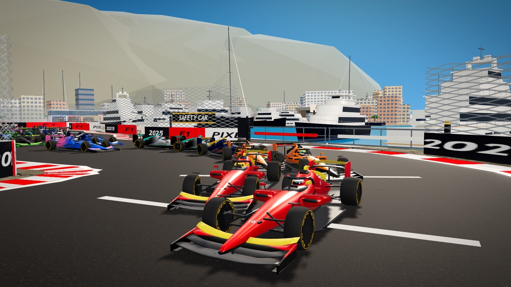
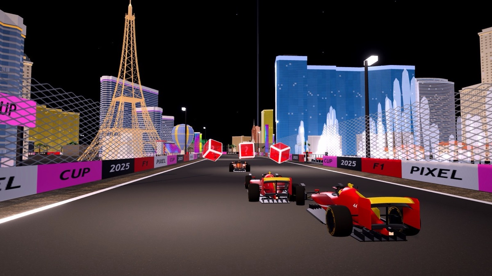
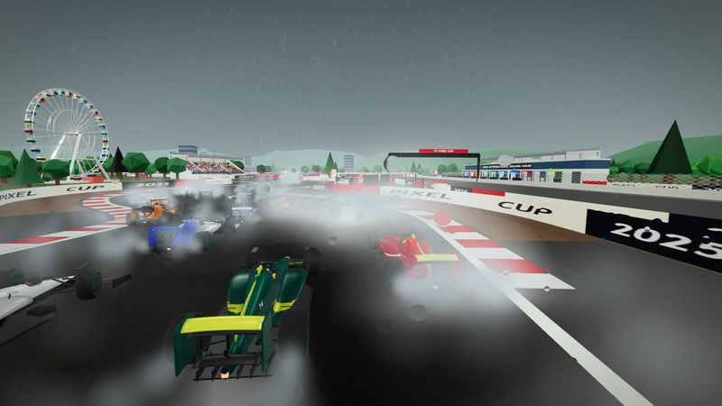
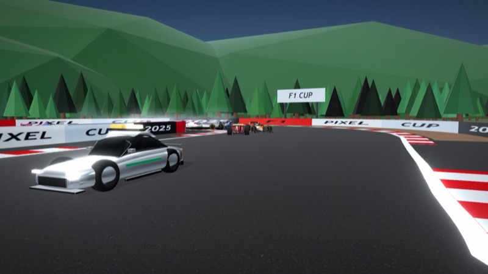
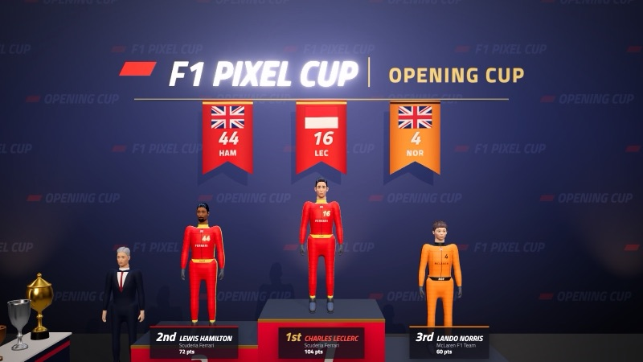
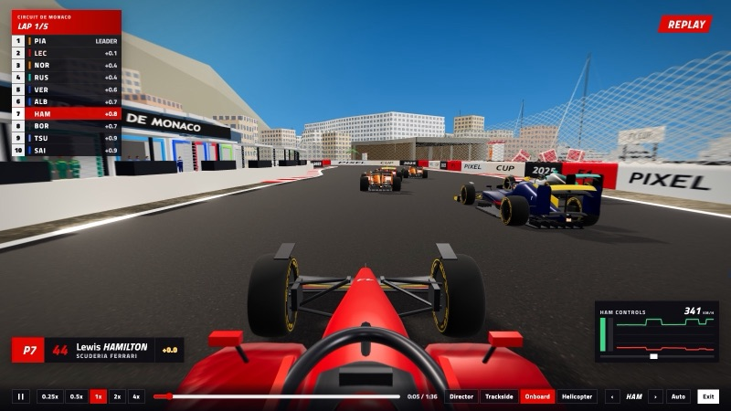
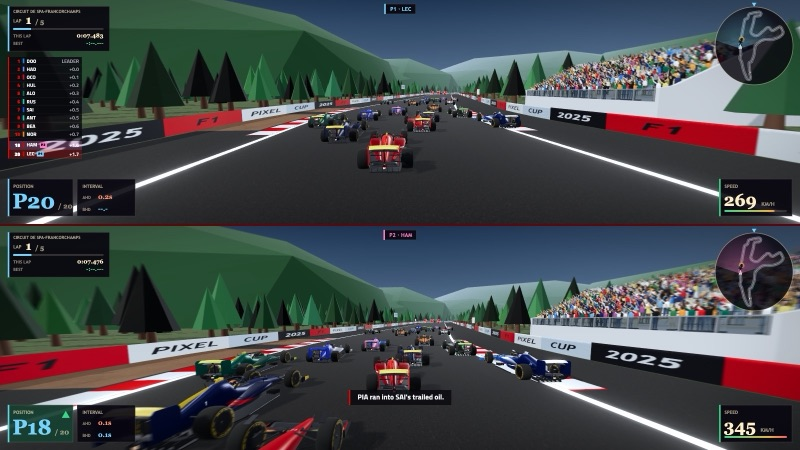
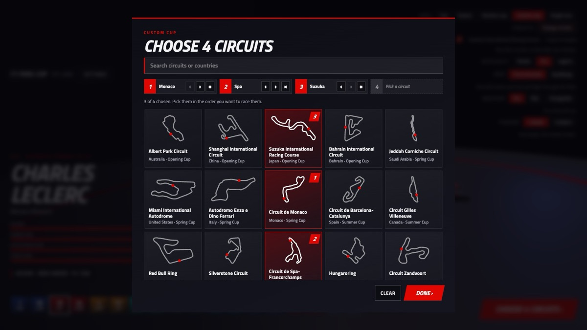

<div align="center">

# F1 PIXEL CUP

**THE 2025 GRID. EVERY 2025 CIRCUIT. IN YOUR BROWSER.**

<a href="https://f1-pixel-cup.vercel.app/play.html"></a>


<a href="LICENSE"></a>
<br/>


</div>

---

<p align="center">
  <a href="https://f1-pixel-cup.vercel.app"></a>
</p>

<p align="center"><em>Monaco, the harbour front. Leclerc's Ferrari leads Hamilton's, the McLarens next and the field strung out behind. Yachts stern to the quay, the hills above the town, a Safety Car gate in the barrier. Click the picture to open the site.</em></p>

<p align="center">
<a href="#gallery">Gallery</a> ·
<a href="#the-honest-physics">Honest physics</a> ·
<a href="#features">Features</a> ·
<a href="#how-to-play">How to play</a> ·
<a href="#controls">Controls</a> ·
<a href="#run-it-yourself">Run it yourself</a> ·
<a href="#credits-and-licences">Credits</a>
</p>

---

## A fan project

I made this because I love the sport. It's free to play, it has no ads, nothing in it is for sale, and I have never made money from it and never will. It isn't affiliated with, endorsed by or connected to Formula 1, Formula One Management, the FIA, or any team or driver.

F1, FORMULA 1 and related marks are trademarks of Formula One Licensing B.V. Driver and team names appear only to say who is who on the grid, and the game uses no official logos or sponsor marks. If you represent any of them and want something changed or taken down, email connorevans29@gmail.com and I'll do it.

---

## What this is

**An F1 racing game that runs in a browser tab, with nothing to install.** Pick any of the 20 drivers from the 2025 season, climb into their team's car and race the other nineteen on real circuits: all 24 of the 2025 calendar, plus eight legends that F1 has left behind.

It is F1 with a Mario Kart heart. The circuits are traced from their real outlines, most pit lanes are where OpenStreetMap puts them, it rains at Spa about as often as it really does, and the scoring is 25, 18, 15. But the races are five laps, item boxes sit on the straights and a blue shell (here, a Steward Penalty) can still ruin the leader's afternoon.

Then the TV bit: replays from four broadcast cameras, with sound; a 3D podium where the top three, each with their own face and their name on their suit, stand for the winner's anthem, are handed bronze, silver and gold, and spray the champagne; and a second player on the same keyboard if you want a fight.

> [!TIP]
> Fastest way in: open **[f1-pixel-cup.vercel.app/play.html](https://f1-pixel-cup.vercel.app/play.html)**, press **Enter** and you're on the grid of the Opening Cup as Charles Leclerc. `W A S D` to drive, `Space` to fire whatever the box gave you.

---

## Gallery

Every picture here comes from the game's own renderer in a 1600x900 window, taken by [`tools/capture-shots.js`](tools/capture-shots.js) (its `readme` part). Some are posed like a photo: a real race, paused, with the named cars placed on the road and a camera set by hand. The others are the game as it plays (the rain shot with its HUD hidden).

<table>
<tr>
<td width="50%"></td>
<td width="50%"></td>
</tr>
<tr>
<td><em><b>The Strip at night.</b> Leclerc leads Hamilton down the Las Vegas Strip, past the half-scale Eiffel Tower and the Bellagio. Every major resort stands where it really does, placed from OpenStreetMap.</em></td>
<td><em><b>Rain.</b> Suzuka in the wet: spray off every car, Hamilton's Ferrari in the thick of it, the Ferris wheel in the murk, and less grip everywhere.</em></td>
</tr>
<tr>
<td width="50%"></td>
<td width="50%"></td>
</tr>
<tr>
<td><em><b>The Safety Car.</b> It drives in through a service gate, here at Spa, catches up to the front and leads the field, then drives back to its garage.</em></td>
<td><em><b>The podium: the anthem.</b> Hamilton, Leclerc and Norris stand for the winner's anthem under their flags, each with their own face, number and team name. The presenter and the trophies wait at the side.</em></td>
</tr>
<tr>
<td width="50%"></td>
<td width="50%"></td>
</tr>
<tr>
<td><em><b>Replays: onboard.</b> Hamilton's T-cam, with his throttle, brake and steering drawn live in the corner.</em></td>
<td><em><b>Two players.</b> Split screen at Spa: P1 (Leclerc) on top, P2 (Hamilton) below, each with their own HUD and mini map.</em></td>
</tr>
</table>

## The honest physics

It's an arcade game, and it says where.

- **A fixed 60 Hz step.** The physics runs in steps of exactly 1/60 s (up to eight a frame), and drawing happens between them, so the game drives the same at 60 Hz and 144 Hz. The race clock is the physics' own time: it advances exactly as far as the physics does and stops while you're paused.
- **Not identical cars.** Every car runs the same physics code, but its numbers come from its team and its driver (speed, handling, acceleration, traction), so a Red Bull is not a Sauber. The pit lane shows the bars.
- **CPU drivers brake like drivers.** They look down the road, work out how fast their car can take what's coming and brake for it (`racecraft.js`). They also steer round traffic, which your own hands do for you.
- **Difficulty, in numbers.** Rookie CPU cars run at 90% pace, Pro at 100%, Legend at 103%. There is catch-up, and it's in the open: a CPU car more than 300 units of road (a second or two at racing speed) ahead of you, or of the leading player in a two-player race, eases off, more the further ahead it is, by up to 8% on Rookie, 4% on Pro and 2% on Legend. Cars near you and behind you are never helped or held back.
- **The tow, and fair contact.** Close behind another car you meet less drag and reach a higher top speed (up to 6%), so you can pull out and pass. Wheel to wheel, cars push each other apart and nobody is thrown back; run into the back of a car and you lose the speed.
- **Steer, or meet the wall.** The barriers are where you see them, past the run-off, and the physics stops you at exactly that line. Your car only settles a little along the road on its own, so if you don't steer through a corner you run wide, off the road and into the wall. You glance off it with a wobble, sparks and dust, and the cars behind slip past while you gather it up.
- **Spinning cars: Mario Kart or F1, your choice.** By default the field drives straight through a car that is spinning or has just hit the wall. Turn on **Spinning cars block the road** in Settings and it is solid instead: the cars behind go round it or lose their speed against it. It applies to you and the CPU cars alike, and takes effect from the next session.
- **Comebacks are possible, and measured.** The power-ups and the pace are tuned by simulating whole races (`tools/balance/`): in those simulations a car starting last on Pro finishes third on average and wins about one race in four; on Legend it nearly always reaches the top ten and rarely wins.
- **Rain is real grip.** In the wet a car has 72% of its dry cornering grip, 85% of its traction and 75% of its braking, oil spins last longer and sliding tyres scrub. Under Monaco's tunnel roof the road stays dry.
- **Same scale everywhere,** so Spa is the longest lap and Monaco the shortest. But for the size of its cars the road is wider than a real one: corners tighter than it can turn are opened out, and stretches that would overlap once widened are nudged apart. Shanghai's snail is the exception: there the road narrows to half its width so the loops can come as close as the real ones.
- **Suzuka really crosses itself,** on a bridge, and each car only looks for road near where it already is, so nobody snaps across the crossover or cuts between two stretches side by side.
- **Nothing over the track, ever.** Every stand, tree, tower, yacht and hill checks its whole footprint against the circuit before it's placed, and `Render3D.auditScenery` drops rays right across the road and run-off all the way round each lap. Every circuit comes back with zero hits.

---

## Features

<table>
<tr>
<td width="33%" valign="top"><br/><b>32 real circuits</b><br/><sub>All 24 of 2025 in calendar order, plus 8 historic ones. Real outlines, real pit lanes, named corners, landmarks at every one.</sub></td>
<td width="33%" valign="top"><br/><b>The 2025 grid</b><br/><sub>20 drivers, 10 teams, each car in its team's paint with its driver's number and helmet.</sub></td>
<td width="33%" valign="top"><br/><b>8 cups and a season</b><br/><sub>Six calendar cups, two historic cups and the full 24-race 2025 Season, saved after every race.</sub></td>
</tr>
<tr>
<td width="33%" valign="top"><br/><b>Race your way</b><br/><sub>A random cup, a custom cup of any four circuits, or a single race.</sub></td>
<td width="33%" valign="top"><br/><b>Weather</b><br/><sub>Dry, Wet, or Changeable: each circuit rains as often as it really does.</sub></td>
<td width="33%" valign="top"><br/><b>8 power-ups</b><br/><sub>F1 ideas with Mario Kart counterparts, from an Oil Slick to the Safety Car.</sub></td>
</tr>
<tr>
<td width="33%" valign="top"><br/><b>TV replays</b><br/><sub>Director, Trackside, Onboard and Helicopter cameras, with broadcast graphics and sound, from 0.25x to 4x.</sub></td>
<td width="33%" valign="top"><br/><b>A 3D podium</b><br/><sub>The top three with their own faces and race suits: the winner's anthem, bronze, silver and gold handed over, then the champagne.</sub></td>
<td width="33%" valign="top"><br/><b>Two players</b><br/><sub>P1 and P2 in split screen on one keyboard or two gamepads, stacked or side by side.</sub></td>
</tr>
<tr>
<td width="33%" valign="top"><br/><b>Trackside life</b><br/><sub>Stands and 3D crowds at every venue, marshals with flags, an official waving the chequered flag through the last lap, a TV helicopter, fireworks at the flag.</sub></td>
<td width="33%" valign="top"><br/><b>A career per driver</b><br/><sub>Points, an Elo-style rating from Karting to World Champion, poles, wins and best laps.</sub></td>
<td width="33%" valign="top"><br/><b>All sound synthesised</b><br/><sub>Engines that start up on the grid and crackle on the lift, tyres, a crowd made of voices, rain, anthems and the start lights, made live with WebAudio. No audio files.</sub></td>
</tr>
</table>

---

## How to play

1. **Open the game** at [f1-pixel-cup.vercel.app/play.html](https://f1-pixel-cup.vercel.app/play.html) (or from the site's front page).
2. **Pick a driver** with `←` `→` or a click. Leclerc is already picked.
3. **Choose the race**: a cup, the season, a random or custom cup, or a single race. Set the difficulty (Rookie, Pro, Legend), the grid and the weather.
4. **Press Enter.** Five red lights, then lights out.
5. **Drive.** Hold `Shift` through a corner to charge a drift boost (the smoke turns white, blue, then orange as it charges), let go for the kick. Drive through the red boxes for a power-up; `Space` uses it.
6. **Five laps later** the whole field finishes the distance, the results come up, and you can **Watch the replay**. After the last race of a cup, the season or a single race: the podium.

> [!NOTE]
> The game is driven with a keyboard or a gamepad. On a phone or tablet it says so, and that touch controls are on the way.

---

## The grid

<details>
<summary>The 2025 line-ups, team by team</summary>

Twenty drivers, ten teams, the 2025 line-ups. Pick a driver and you race their team's car, in its colours, with their number on the nose and engine cover and their own helmet design in the cockpit.

| Team | Car | Drivers |
|---|---|---|
| **Ferrari** | SF-25 | **16** Charles Leclerc · **44** Lewis Hamilton |
| **McLaren** | MCL39 | **4** Lando Norris · **81** Oscar Piastri |
| **Red Bull** | RB21 | **1** Max Verstappen · **30** Liam Lawson |
| **Mercedes** | W16 | **63** George Russell · **12** Kimi Antonelli |
| **Aston Martin** | AMR25 | **14** Fernando Alonso · **18** Lance Stroll |
| **Alpine** | A525 | **10** Pierre Gasly · **7** Jack Doohan |
| **Williams** | FW47 | **23** Alex Albon · **55** Carlos Sainz |
| **Haas** | VF-25 | **87** Oliver Bearman · **31** Esteban Ocon |
| **Racing Bulls** | VCARB 02 | **22** Yuki Tsunoda · **6** Isack Hadjar |
| **Sauber** | C45 | **27** Nico Hülkenberg · **5** Gabriel Bortoleto |

</details>

---

## The circuits

<details>
<summary>All 32 circuits: lap length, how often it rains, and what stands there</summary>

All 32, at one scale, five laps each.  marks the night races, run under floodlights, a moon and stars (unless rain clouds hide them);  the historic circuits. The rain column is how often Changeable weather turns wet there.

| | Circuit | Lap | Rain | What's there |
|---|---|---|---|---|
| 1 | Albert Park, Australia | 5.278 km | 20% | Melbourne's skyline over the lake |
| 2 | Shanghai, China | 5.451 km | 30% | The snail at turns 1 and 2, as tight as the real one, and its grandstand |
| 3 | Suzuka, Japan | 5.807 km | 30% | The figure of eight on its bridge, and the Ferris wheel |
| 4 | Bahrain | 5.412 km | 2% | Desert twilight under floodlights, the Sakhir tower, heat haze |
| 5 | Jeddah, Saudi Arabia  | 6.175 km | 2% | The fountain, yachts out at sea |
| 6 | Miami, United States | 5.412 km | 15% | The stadium |
| 7 | Imola, Italy | 4.909 km | 30% | The hillside at Tosa; Tamburello, Piratella and Rivazza on their boards |
| 8 | Monaco | 3.337 km | 15% | The casino, the tunnel, the harbour full of yachts |
| 9 | Barcelona, Spain | 4.655 km | 10% | Its grandstand |
| 10 | Montréal, Canada | 4.361 km | 30% | The Biosphère |
| 11 | Red Bull Ring, Austria | 4.318 km | 30% | The Spielberg grandstand and the hillside |
| 12 | Silverstone, Great Britain | 5.891 km | 35% | The Wing |
| 13 | Spa-Francorchamps, Belgium | 7.004 km | 50% | Eau Rouge and Raidillon, the Ardennes forest, the pits |
| 14 | Hungaroring, Hungary | 4.381 km | 20% | The hillside |
| 15 | Zandvoort, Netherlands | 4.259 km | 30% | The Hugenholtz terraces |
| 16 | Monza, Italy | 5.793 km | 15% | The old banking |
| 17 | Baku, Azerbaijan | 6.003 km | 5% | The Flame Towers, the old city, yachts |
| 18 | Singapore  | 4.928 km | 25% | Marina Bay Sands, the Flyer, yachts on the bay |
| 19 | Circuit of the Americas, Austin, United States | 5.514 km | 10% | The tower and the hill up to Turn 1 |
| 20 | Mexico City | 4.304 km | 15% | Foro Sol |
| 21 | Interlagos, Brazil | 4.309 km | 40% | São Paulo's towers and the lake |
| 22 | Las Vegas, United States  | 6.201 km | 2% | The whole Strip, the Sphere showing the Earth, 30 stands |
| 23 | Lusail, Qatar  | 5.380 km | 2% | Its grandstand and Lusail's towers |
| 24 | Yas Marina, Abu Dhabi  | 5.281 km | 2% | The Yas hotel, yachts in the marina |
|  | Hockenheimring, Germany | 4.574 km | 25% | The Motodrom's great stand across from the pits, in the Rhine plain's pine forest |
|  | Nürburgring, Germany | 5.148 km | 40% | The ruined Nürburg on its wooded hill above its village, Eifel forest all round |
|  | Estoril, Portugal | 4.182 km | 15% | The Serra de Sintra with the Pena Palace on top, the Atlantic to the south |
|  | Kyalami, South Africa | 4.529 km | 15% | Johannesburg's skyline on the horizon, the Highveld's dry grass and acacias |
|  | Sepang, Malaysia | 5.543 km | 45% | The double-fronted grandstand under its palm-leaf canopies, oil palms everywhere |
|  | Istanbul Park, Türkiye | 5.338 km | 15% | The grandstand hung from its masts, and the bank outside Turn 8 |
|  | Mugello, Italy | 5.245 km | 15% | A terraced Tuscan hill with its farmhouse and cypresses |
|  | Watkins Glen, United States | 5.430 km | 30% | A Finger Lake between autumn woods |

Every circuit has its pit lane and garages, stands and a crowd, marshal posts and a TV helicopter, and its own ground, sky, colour grade and trees or city. Every venue has its landmarks, built in Blender, the historic circuits too.

Las Vegas has the whole Strip: every major resort from the Strat to Mandalay Bay stands where OpenStreetMap puts it, each in its own stone or glass. Among them are the half-scale Eiffel Tower, the Bellagio's lake and its fountain show, the Venetian's campanile, the Colosseum at Caesars Palace, the High Roller, the Luxor's pyramid and beam, and the Sphere with the Earth on its skin. The ground between the towers is filled in from the same map (low buildings, car parks, pools, roads, the monorail), and 30 stands line the lap.

> [!NOTE]
> **Where the pits are.** Where OpenStreetMap maps the real pit lane, the game's sits beside it, on its real side. Three don't: at Interlagos the real lane leaves the track through the Senna S and at Singapore its side bends too tightly for garages, so theirs are across the road, and Monaco's is placed by hand. Albert Park, Monza, Suzuka and Las Vegas have none mapped, so theirs come from the circuit's shape.

</details>

---

## Cups, seasons and your own way

<details>
<summary>The race choices, the eight cups, the settings and your career</summary>

### The race choices

| Choice | What you race |
|---|---|
| **Cup** | One of eight four-race cups (below). |
| **Season** | The **2025 Season**: all 24 races in calendar order, for the drivers' and the constructors' titles. Saved after every race and resumed from the pit lane, ties broken on countback. One player. |
| **Random cup** | Four circuits drawn from all 32, no repeats. Don't like the draw? Reroll. |
| **Custom cup** | Any four circuits, in the order you choose, from a picker you can search. |
| **Single race** | One circuit, chosen or drawn at random. |

<p align="center">
  
</p>

<p align="center"><em>The circuit picker building a custom cup: Monaco, Spa, Suzuka and one to go.</em></p>

### The cups

| Cup | Races |
|---|---|
| **Opening Cup** | Albert Park · Shanghai · Suzuka · Bahrain |
| **Spring Cup** | Jeddah · Miami · Imola · Monaco |
| **Summer Cup** | Barcelona · Montréal · Red Bull Ring · Silverstone |
| **Classics Cup** | Spa-Francorchamps · Hungaroring · Zandvoort · Monza |
| **Autumn Cup** | Baku · Singapore · Circuit of the Americas · Mexico City |
| **Finale Cup** | Interlagos · Las Vegas · Lusail · Yas Marina |
|  **Legends Cup** | Hockenheimring · Nürburgring · Estoril · Kyalami |
|  **Golden Era Cup** | Sepang · Istanbul Park · Mugello · Watkins Glen |

The 2025 grid races the historic circuits too. Each is the layout its outline data holds, and the game says which: Hockenheim is the short Grand Prix circuit raced from 2002 to 2019, the Nürburgring the Grand Prix circuit of 2002 to 2020, Sepang the F1 circuit of 1999 to 2017, Istanbul Park as raced in 2005 to 2011 and 2020 to 2021, Mugello as raced in 2020, and Watkins Glen the long circuit with the Boot, close to its F1 layout of 1975 to 1980; Estoril and Kyalami are today's circuits, not the ones F1 raced.

### The settings that change a race

- **Difficulty:** Rookie, Pro (the default) or Legend. What changes is how the CPU drivers drive (how far ahead they look, how close to the limit they corner, how tidy their line is, how often they make a mistake) and a pace factor; [the physics section](#the-honest-physics) has the numbers.
- **Grid:** *From the back* (the default, Mario Kart style: you start last and the CPU cars line up by the cup standings, leader on pole) or *Qualifying*: one flying lap from a rolling start, every CPU lap simulated with the same physics.
- **Weather:** *Dry*, *Wet* (every race) or *Changeable*, where each race rolls once against how often it really rains there: Spa one race in two, Sepang, Interlagos and the Nürburgring nearly as often, the desert races almost never.
- **Scoring:** 25, 18, 15, 12, 10, 8, 6, 4, 2, 1, and a point for the fastest lap if you finish in the top ten.

### Your career

Every driver keeps their own career, saved in the browser. **Career points** only go up: the race's F1 points, a cup bonus of 50, 30 or 20 for the top three and points for qualifying, all times the difficulty (Rookie x1, Pro x2, Legend x3). The **rating** goes up and down: it starts at 1200 and moves Elo-style against a field of fixed strength for each difficulty, through the tiers Karting, F4, F3, F2, F1 and World Champion (1850 and up). Best laps, poles, wins and the race history are kept too.

</details>

---

## The power-ups

<details>
<summary>The eight power-ups and their Mario Kart counterparts</summary>

Drive through a red box and the roulette spins. What you get depends on your place, or on how far you are behind the leader if that puts you further back, with Mario Kart 8 Deluxe's shape of odds: the weak items are common and the strong ones rare, and the back of the field gets the fast ones most. A broken box is back in two seconds, so the cars at the back get theirs too.

| Item | Mario Kart | What it does |
|---|---|---|
| <br/>**DRS** | Mushroom | A burst of speed at once, then the rear wing's flap really opens: three seconds of boost, four and a half on a straight. |
| <br/>**Oil&nbsp;Slick** | Banana | Tap to drop it: it lies for fifteen seconds and gives a short spin to whoever drives through it, you included. Hold `Space` to trail it instead: it blocks one Undercut or Debris from behind, or spins the first car that runs into it. |
| <br/>**Debris** | Green shell | Fired straight ahead, fast; bounces off the track's edges for eight seconds and spins anyone it hits, you included. |
| <br/>**Undercut** | Red shell | Homes in on the car ahead, round every corner, and spins it. |
| <br/>**Overtake&nbsp;Mode** | Star | Eight seconds faster and untouchable; cars you touch spin and are knocked aside. |
| <br/>**Formation&nbsp;Lap** | Bullet Bill | Six seconds of autopilot at huge speed straight through the field, knocking cars aside; at the end it carries you on, for up to two seconds more, until you are clear of other cars. |
| <br/>**Steward&nbsp;Penalty** | Blue shell | Flies over the field to the leader: the heaviest hit in the game, a near stop and a long spin, and a spin for anyone right beside them. If it lands on you, you hear the steward's whistle. |
| <br/>**Safety&nbsp;Car** | Lightning | Joins by whichever of the circuit's service gates (or the pit exit) gets it in front of the leader soonest, then leads for seven seconds; every rival loses their power-up, is slowed to its pace and can't overtake. You aren't. A yellow SAFETY CAR sign and its own two-tone warning tell everyone it is out. |

> [!NOTE]
> **The limits.** No box gives one of the three strongest (Formation Lap, Steward Penalty, Safety Car) in the first fifteen seconds of a race. No box gives a Steward Penalty within 60 seconds of the last one fired, or a Safety Car within 30 seconds of the last (or in the first 20). After a spin, a car can't be spun again for four and a half seconds.

Shots, oil and the Safety Car move along the track itself, so they follow every corner and never meet a car on the other level of Suzuka's crossover.

</details>

---

## Race day

<details>
<summary>The replays, the podium ceremony and two players</summary>

###  The replays

Every race is recorded at 30 samples a second, so when the results come up you can **Watch the replay**.

- **Four cameras.** *Trackside* (TV cameras round the lap that pan and zoom after the car, then cut to the next), *Onboard* (the T-cam, with that driver's throttle, brake and steering drawn live), *Helicopter*, and the *Director*, who opens on the leader from the air, then cuts every six seconds between Trackside, Onboard and Helicopter shots, following the closest battle in the top six (or you, when there isn't one).
- **Broadcast graphics.** A timing tower, a lower-third with the car in view, a seek bar and five speeds: 0.25x, 0.5x, 1x, 2x and 4x.
- **Sound, heard from the camera.** The engine close and level onboard; the cars coming and going past a trackside camera, with the Doppler shift. Full sound at 0.5x, 1x and 2x; the venue only at 0.25x and 4x.
- **Your car or the director's.** Pick a car and every camera stays on it; **Auto** (or `A`) hands the choice of cars back to the director.

###  The podium

After a cup, the season or a single race, the top three stand on their steps in 3D, and it runs as a real podium does:

1. **The arrival.** The camera sweeps in and the arms go up (third, then second, then first, each stepping forward) as the crowd cheers.
2. **The winner's anthem.** All three stand while the camera pushes slowly in on the winner under their flag. The anthem is an instrumental the game synthesises itself from the notes of the score (a brass band in a hall; never a recording).
3. **The trophies.** Three wait on a table beside the podium: a bronze cup for third, a bigger silver goblet for second, a grand gold urn with handles and a lid for the winner. A presenter in formal dress (a man in a dark suit and tie or a woman in a green trouser suit; the same one for the same podium) carries each to its driver at a walking pace, holds it up, and nods as it is taken. Third and second lift theirs; the winner's lift is the big one, to a fanfare, confetti cannons and the crowd's roar.
4. **The champagne.** A cork for each bottle and the spray (on Medium and High graphics), trophy in one hand and bottle in the other, then a slow orbit for as long as you want to watch.

**Race suits.** Each driver wears their team's colours with their race number on the chest, their flag under the collar and the team's name in plain capitals across the chest, their three-letter code on the belt; on the back, their surname over a big number. Words, numbers and flags only: no logos and no crests. Behind them, the name plates carry the points and each banner the driver's flag, number and team colours.

**13 anthems for all 20 drivers:** *Hymne Monégasque* (Monaco), *God Save the King* (United Kingdom), *Wilhelmus* (Netherlands), *Advance Australia Fair* (Australia), *Il Canto degli Italiani* (Italy), *Marcha Real* (Spain), *O Canada* (Canada), *La Marseillaise* (France), *Phleng Chat Thai* (Thailand), *Das Lied der Deutschen* (Germany), *Kimigayo* (Japan), *God Defend New Zealand* (New Zealand), *Hino Nacional Brasileiro* (Brazil).

**A crowd made of voices.** Shouts on vowels, whistles, horns and hand claps, not noise, here and in the grandstands during a race. Every sound is made by the game and follows its sound setting; with the sound off the ceremony pauses only briefly where the anthem would be.

> [!NOTE]
> Each arm is solved every frame to put its hand on the trophy's stem or foot. The checks hold every hand to within 3 cm of where it is put, and every forearm and body clear of the cups.

###  Two players

Turn on *2 players* in the pit lane, pick P2's driver (it can't be P1's), and both of you race the same field, each with your own view, HUD, mini map and career. The season is one player's championship.

</details>

---

## Controls

<details>
<summary>Keyboard, two players, gamepads and replay keys</summary>

###  One player

| Action | Keys |
|---|---|
| Throttle | `W` or `↑` |
| Brake, then reverse | `S` or `↓` |
| Steer | `A` `D` or `←` `→` |
| Drift (charge a boost) | hold `Shift` while turning |
| Use the power-up | `Space` (Oil Slick: tap to drop, hold to trail) |
| Pause | `Esc` or `P` (race, countdown and qualifying) |
| Full screen, on and off | `F` (or double-click the picture) |
| Quit while paused | `Q` (after the flag, `Q` keeps your result) |
| Next race, or from qualifying to the race | `Enter` |
| Back to the pit lane from results or the podium | `Esc` |
| In the pit lane: change driver, start | `←` `→`, `Enter` |

###  P1 and P2

| | Throttle | Brake | Steer | Drift | Power-up |
|---|---|---|---|---|---|
| **P1** | `W` | `S` | `A` `D` | Left `Shift` | `Space` |
| **P2** | `↑` | `↓` | `←` `→` | Right `Shift` | `/` (left of Right `Shift`) |

Keys are read by position, and the pit lane labels them for your keyboard layout (AZERTY shows `Z Q S D`). The two views stack one above the other, or sit side by side once the window is more than 2.1 times as wide as it is tall.

###  Gamepads

The first pad is P1's, the second P2's (standard mapping), and a pad and the keys work together.

| Action | Pad |
|---|---|
| Steer | left stick or d-pad |
| Throttle | right trigger or the bottom face button |
| Brake and reverse | left trigger or the right face button |
| Drift | either bumper |
| Power-up | the left or top face button |
| Pause | Start |

###  Replay keys

| Action | Keys |
|---|---|
| Play or pause | `Space` |
| Back or forward 5 s | `←` `→` |
| Previous or next car | `↑` `↓` |
| Slower or faster (0.25x to 4x) | `-` and `=` (or `_` and `+`) |
| Next camera | `C` |
| Auto: the director picks the cars again | `A` |
| Leave the replay | `X` or `Esc` |

### Settings

| Setting | Choices |
|---|---|
| Sound | On or off |
| Full screen | On or off (`F` anywhere, or double-click the picture) |
| Spinning cars block the road | Off by default. On, a spinning car is solid (see [the physics](#the-honest-physics)); it applies from the next session |
| Graphics | Auto, High (the default), Medium or Low |

---

</details>

---

## Under the hood

```
play.html          the game, full window          index.html      the website (no 3D, loads fast)
game.js            physics, AI, laps, items, the HUD and the pit-lane flow
screens.js         the pit lane, results, replay and podium screens, Settings
render3d.js, r3d/  the three.js renderer: car, track, landmarks, the Strip, trackside, people,
                   rain, post-processing, the podium, its trophies and presenter, suits, cameras
*.js (pure)        UMD modules tested in Node: weather, racecraft, grid, season, career, choices,
                   replay, ceremony, faces, suits, twoplayer, powerups, pitlane, entrances,
                   runoff, siting, marshals, venue, quality...
*-sound(s).js      the synths: engine-sound, crowd-sound, podium-sound, signal-sounds; anthem-data
tracks-data.js     the 32 circuits, generated by tools/tracks/
assets/            Blender-built GLBs (car, driver, items, landmarks, people, yachts), textures
tools/blender/     the build scripts for every model, headless and self-checking
tools/             tracks/ vegas/ sphere/ anthems/ balance/ perf/ site/ readme/, capture-shots.js
tools/checks/      the browser checks          tests/      the Node tests
```

- **No build step.** Plain scripts and one ES module renderer on [three.js](https://threejs.org) r186 (vendored, loaded through an import map), and a 2D canvas over the top for the HUD. If WebGL isn't there, the original 2D renderer takes over.
- **Built in Blender, from code.** The car, the driver figure, the power-up models, the landmarks of all 32 venues, the Las Vegas Strip, the grandstands, the crowd and crews, and the yachts are all generated by Python scripts in `tools/blender/`, run headless (`Blender -b --factory-startup -P <script>`). Each script checks its own result and refuses to write a broken model; the trackside models are compressed with meshopt. The trophies are turned on a lathe in three.js, and the presenter is built on the driver figure.
- **Faces without photos.** The drivers' heads are MakeHuman's CC0 base mesh with its shape targets baked into shape keys. Each driver's look (shape sliders from a set of about forty, hair, beard, brows, eye and skin colour) is data in `game-data.js`; hair and beards are shells of fur. Public photos were used as reference only.
- **Circuits from open data.** Outlines from [bacinger/f1-circuits](https://github.com/bacinger/f1-circuits) and pit lanes, the Monaco and Silverstone start lines, the Monaco tunnel and the named corners from OpenStreetMap, through `tools/tracks/fetch_osm.py` and `build_tracks.py`. The Las Vegas Strip's buildings and the ground between them come from OpenStreetMap too (`tools/vegas/`), and the Sphere's Earth from NASA (`tools/sphere/`).
- **Sound from nothing.** Every sound is synthesised live with WebAudio, the anthems included: `tools/anthems/` reads each melody from a public-domain score or MIDI file into notes (`anthem-data.js`), and the game's own brass band plays them.
- **Shaders compile behind the loading panel.** `Render3D.prepare()` builds each circuit, compiles every shader and uploads every texture before the countdown, so the first frame never stalls. Only the raced venue's models are loaded.
- **High by default, with dynamic resolution.** Graphics run on three tiers (High, Medium, Low; High unless you choose otherwise, or Auto to let the game pick). The 3D picture's pixel ratio is capped per tier (2 on High, 1.5 on Medium, 1 on Low) and steps down an eighth at a time when frames miss 60 a second, to a floor of 1.25, 1 or 0.75, then back up when there is room; Auto drops a tier only once that has run out. The HUD always draws at the screen's own resolution.
- **Checked twice.** `npm test` runs 566 Node tests (scoring, odds, weather, grids, the season, replays, the ceremony's timeline, anthems, suits, faces, the circuits' data, this README...). Then 30 browser checks in `tools/checks/` drive the real game in Playwright at real window sizes: every power-up, the balance, the season's save and resume, the podium, the replays, the sound, split screen, frame times, nothing over the track on every circuit, the view filling any window with no black bars. `tools/checks/run-all.js` lists them; its header shows how to run them against the dev server.

> [!NOTE]
> **Measured, not guessed.** On the development machine (a 120 Hz Retina screen, a 3456x2234 drawing buffer) a race frame at Monaco on High costs 8 to 10 ms of GPU at a pixel ratio of 2, 7.9 ms at 1.5 and 4.8 ms at 1. Each car casts its shadow from one mesh, which took Monaco's shadow map from about 440 draws a frame to under 100 (`docs/superpowers/specs/2026-10-05-performance-headroom-design.md`).

### Run it yourself

```bash
git clone https://github.com/AllStreets/F1PixelCup.git
cd F1PixelCup
python3 tools/dev-server.py .      # http://localhost:8765, caching off
npm test                           # Node 22, no dependencies to install
```

It has to be served over HTTP (the renderer is an ES module and loads models), so opening `play.html` from disk falls back to the 2D renderer. Any static server works.

<details>
<summary><b>Deploying, and retaking these pictures</b></summary>

<br/>

**Live:** https://f1-pixel-cup.vercel.app. The Vercel project follows this repo: every push to `main` deploys, other branches get preview URLs, and `.vercelignore` keeps `docs/`, `tests/` and `tools/` out of the upload.

**The README's pictures** come from `tools/capture-shots.js` with `globalThis.CAPTURE_PARTS = ["readme"]` against the dev server (`globalThis.README_ONLY` retakes just some: `hero`, `harbour`, `cars`, `night`, `rain`, `replay`, `podium`, `split`, and `pitlane`, which takes the picker too). `vegas.jpg` (1200 wide) and `safety-car.jpg` (800) are the same shots as the site's (the script's `vegas` and `ontrack` parts), sized from the full captures. They're written full size to `docs/readme/`, then sized for GitHub with `sips -s formatOptions 80 hero.jpg`, `sips -Z 1200 -s formatOptions 80` for `picker.jpg` (so its text stays readable) and `sips -Z 800 -s formatOptions 78` for the rest.

**The README's icons** are drawn by `node tools/readme/build-icons.js` into `docs/readme/icons/`, in the style of the game's own power-up icons (`item-icons.js`), which it writes out as they are. `tests/readme.test.js` fails if the README gains an emoji, an em dash or an en dash, points at a file that isn't there, or the icons are stale.

</details>

---

## How it came together

It didn't start in 3D. It started as a pixel-art kart racer with a pseudo-3D road drawn on a canvas, which is where the name comes from (and that view is still there, as the fallback when WebGL isn't available).

| When | What arrived |
|---|---|
| **Apr 2026** · *pixels* | A Mario Kart clone becomes F1 Pixel Cup 2025: the 2025 grid in pixel-art cars, F1 power-ups and F1 points, on eight hand-drawn tracks named after real circuits. |
| **Sep 7** · *a real race* | One chase camera, the heading-up mini map and the race HUD, five-lap races, sound, difficulties, a whole field that finishes the distance. |
| **Sep 27** · *3D, and a website* | The race moves to three.js with a Blender-built car, onto the real circuits, with landmarks and liveries, and scenery that never touches the track. Career scoring, and the website. |
| **Sep 28** · *power-ups and qualifying* | The eight F1 power-ups rebuilt to follow the track, a real Safety Car and DRS flap, real race times, qualifying and a difficulty that changes the field. |
| **Sep 29 to 30** · *a world* | A career per driver, the power-ups' beauty pass, painted helmets, the 2025 grid's pages on the site, broadcast post-processing, pit lanes from OpenStreetMap, marshals and the helicopter, rain with real wet grip, car v2 and the Blender driver figure. |
| **Oct 1 to 2** · *race day* | TV-camera replays, the 3D podium ceremony and two-player split screen. |
| **Oct 4 to 5** · *the whole calendar* | The drivers' own faces; landmarks, yachts, stands and 3D crowds at every venue; all 24 circuits of 2025 in six cups and the Season; random, custom and single races; the Legends and Golden Era cups. Then this README. |
| **Oct 5 to 10** · *sound and fury* | Sound in the replays and an engine that starts up, shimmers flat out, crackles on the lift and rings in the tunnel; the Safety Car's service gates, its sign and its warning; the official with the chequered flag; steering that matters, barrier hits and comebacks from the back; landmarks at the historic circuits; a moon over the night races; High graphics by default with dynamic resolution; and the whole Las Vegas Strip, building by building, with the ground between filled in. |
| **Oct 11** · *the ceremony* | Las Vegas's 30 stands and the Sphere's turning Earth; the podium's sound and the winner's anthem (13 of them, for all 20 drivers); a crowd made of voices; race suits with numbers, names, flags and team names; the trophy presentation in bronze, silver and gold; `F` for the full screen. Then this README's second pass, with its own icons. |

### What's next

- [ ] **Accounts,** so a career follows you from one browser to another.
- [ ] **Touch controls** for phones and tablets.

---

## Credits and licences

| What | From | Licence |
|---|---|---|
| Circuit outlines | [bacinger/f1-circuits](https://github.com/bacinger/f1-circuits) | MIT |
| Pit lanes, the Monaco and Silverstone start lines, the Monaco tunnel, corner names, the Las Vegas Strip's buildings and the ground between them | [© OpenStreetMap contributors](https://www.openstreetmap.org/copyright) | ODbL |
| The website's race data (the drivers' and teams' pages) | [F1DB](https://github.com/f1db/f1db) by Marcel Overdijk | CC BY 4.0 |
| Ground textures | [Poly Haven](https://polyhaven.com) | CC0 |
| The Earth on the Las Vegas Sphere ([Blue Marble](https://visibleearth.nasa.gov/images/73909) and its [clouds](https://visibleearth.nasa.gov/images/57747)) | NASA Earth Observatory / Visible Earth | Public domain |
| The drivers' heads (base mesh and shape targets, data only) | [MakeHuman](https://github.com/makehumancommunity/makehuman) | CC0 |
| 3D engine | [three.js](https://github.com/mrdoob/three.js) | MIT |
| Model decompression | [meshoptimizer](https://github.com/zeux/meshoptimizer)'s decoder, shipped with three.js | MIT |
| The podium's anthems (the notes only: melodies from MIDI files and scores, played by the game's own synth) | Wikimedia Commons, [nationalanthems.info](https://nationalanthems.info) and IMSLP, each listed in [THIRD-PARTY-NOTICES](THIRD-PARTY-NOTICES); the compositions are in the public domain (Thailand's in Thailand; see the notices) | Public domain, CC0 and CC BY 4.0 |
| Typeface | [Titillium Web](https://fonts.google.com/specimen/Titillium+Web), from Google Fonts | SIL OFL 1.1 |
| This README's icons | Drawn for this project in the style of the game's own power-up icons (`tools/readme/build-icons.js`) | MIT, with the code |

The game's own code is released under the [MIT License](LICENSE). The pieces above keep their own licences, and the notices for those shipped here are in [THIRD-PARTY-NOTICES](THIRD-PARTY-NOTICES).

F1 Pixel Cup is a fan-made game. It isn't affiliated with Formula 1, the FIA or any team, and it carries no official logos or sponsor marks: the names and numbers on the cars and the race suits are the drivers', the team names are plain words, and the paint is each team's colours. It's free and non-commercial, and nobody makes money from it. See [A fan project](#a-fan-project).
